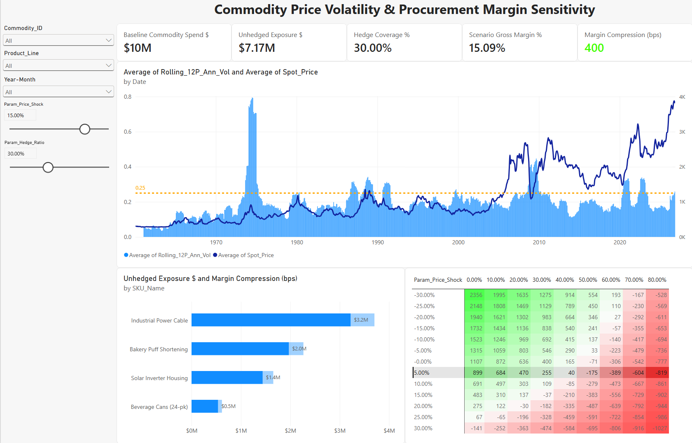
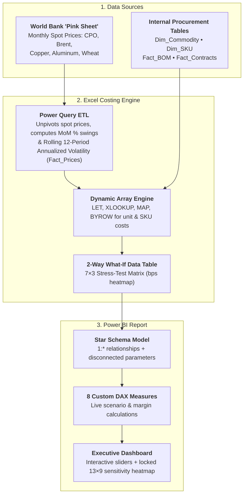
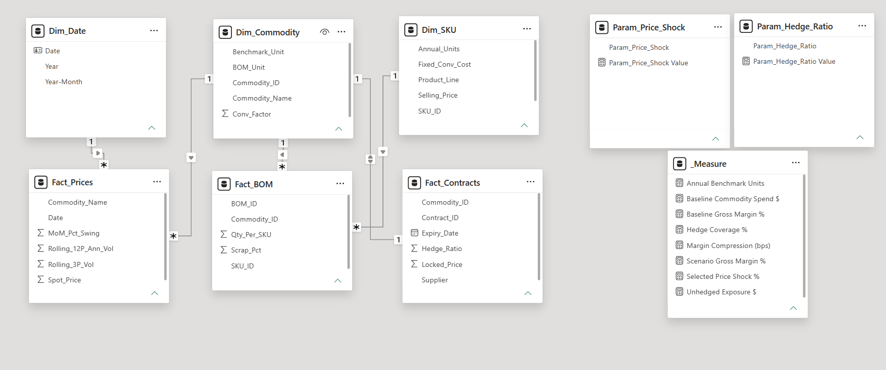

# Commodity Price Volatility & Procurement Margin Sensitivity Model

An end-to-end financial modeling and executive analytics solution built with **Excel (Power Query, Dynamic Arrays, What-If Data Tables)** and **Power BI (Star Schema, DAX, Interactive What-If Parameters)**. The model quantifies how raw material price shocks and supplier hedging strategies impact unit Bill of Materials (BOM) costs, SKU-level profitability, and portfolio gross margins.



---

## Executive Summary & Business Problem

Manufacturing and consumer goods procurement teams face severe margin compression when global commodity markets experience sudden price spikes. Static spreadsheets fail to capture the non-linear interaction between multi-ingredient product recipes (BOMs), manufacturing scrap rates, partial supplier forward contracts, and market spot volatility.

This project bridges granular **Excel financial engineering** with an interactive **Power BI executive decision dashboard** to answer three core leadership questions:
1. **Exposure Quantification:** How much annual procurement spend remains unhedged across key raw materials?
2. **Margin Sensitivity:** How many basis points (`bps`) of gross margin are gained or eroded across combined price shock (`-30%` to `+30%`) and hedge coverage (`0%` to `80%`) scenarios?
3. **SKU Vulnerability:** Which finished goods carry the highest dollar exposure and margin sensitivity to raw material inflation?

---

## Key Analytical Insights

Based on the baseline valuation date (`2026-10-31`) across 5 global commodities and 4 finished SKUs (`$10M` baseline annual commodity spend):

* **Hedge Protection Value (`+614 bps`):** At `0%` spot price shock, maintaining a `50%` locked supplier hedge lifts portfolio gross margin from **`22.15%`** (unhedged baseline) to **`28.30%`**—a **`+614 bps`** structural margin advantage driven by favorable locked contract pricing.
* **Stress-Test Compression (`-37 bps`):** Under a **`+15%` commodity price shock** with **`30%` hedge coverage**, unhedged exposure reaches **`$8.24M`**, compressing scenario gross margin to **`10.72%`** (**`-37 bps`** vs. baseline).
* **SKU Concentration Risk:** **Industrial Power Cable (`SKU-101`)** represents the single largest vulnerability at **`$3.7M`** in unhedged exposure (heavily driven by Copper and Aluminum BOM intensity), followed by **Bakery Puff Shortening (`SKU-102`)** at **`$2.3M`**, **Solar Inverter Housing (`SKU-104`)** at **`$1.7M`**, and **Beverage Cans (`SKU-103`)** at **`$0.6M`**.
* **Volatility Regime Detection:** Tracking Rolling 12-Period Annualized Volatility against a **`0.25` (`25%`)** risk threshold highlights historical regime shifts where proactive forward contracting protects operating margins.

---

## Data Flow



---

## Technical Implementation

### 1. Data Model & Inputs
* **External Market Data (`Fact_Prices`):** Historical monthly benchmark prices sourced from the World Bank Commodity Markets ("Pink Sheet") for **Crude Palm Oil (`COM-01`)**, **Brent Crude Oil (`COM-02`)**, **Copper (`COM-03`)**, **Aluminum (`COM-04`)**, and **US HRW Wheat (`COM-05`)**.
* **Internal ERP Tables:**
  * `Dim_Commodity`: Commodity metadata and unit conversion factors (`$/mt` or `$/bbl` to `$/kg` or `$/L`).
  * `Dim_SKU`: Product catalog (`SKU-101` to `SKU-104`), selling prices, fixed conversion costs, and annual volume forecasts.
  * `Fact_BOM`: Multi-commodity recipe quantities and manufacturing scrap percentages per SKU.
  * `Fact_Contracts`: Active supplier forward contract prices and baseline hedge ratios.

### 2. Excel Dynamic Array Engine (`Procurement_Model.xlsx`)
* **Power Query Pipeline:** Cleans raw market series, standardizes dates, and computes rolling 12-month annualized price volatility.
* **Spill-Dynamic Cost & Margin Engine:** Built with modern Excel functions (`LET`, `MAP`, `BYROW`, `XLOOKUP`, `SUMPRODUCT`) so adding new commodities or SKUs automatically expands calculations without manual formula dragging.
* **2-Way What-If Data Table:** Evaluates portfolio margin compression (`bps`) across simultaneous variations in market price shock and hedge ratio override, styled with a Red–White–Green conditional heatmap.


### 3. Power BI Star Schema & DAX Measures (`Procurement_Dashboard.pbix`)
* **Star Schema Modeling:** Enforces strict single-direction `1:*` relationships from `Dim_Date`, `Dim_Commodity`, and `Dim_SKU` to `Fact_Prices`, `Fact_BOM`, and `Fact_Contracts`, preventing ambiguous fact-to-fact filtering.



* **Disconnected What-If Parameters:** Two numeric range parameters (`Param_Price_Shock` and `Param_Hedge_Ratio`) drive real-time scenario modeling while visual interaction rules (`Edit interactions → None`) keep the `13 × 9` sensitivity matrix permanently visible.
* **Core DAX Logic:**
  * `Baseline Commodity Spend $`: Evaluates total annual BOM material cost at the latest valuation spot price, accounting for scrap loss and unit conversion factors.
  * `Unhedged Exposure $`: Dynamically computes remaining dollar spend exposed to market spot fluctuations under active shock and hedge overrides.
  * `Scenario Gross Margin %` & `Baseline Gross Margin %`: Blends locked supplier contract spend with shocked unhedged spend, utilizing `REMOVEFILTERS()` to preserve an invariant baseline benchmark.
  * `Margin Compression (bps)`: Quantifies scenario margin delta in basis points (`([Scenario Gross Margin %] - [Baseline Gross Margin %]) * 10000`).

---

## Repository Structure

```text
├── data/
│   └── World_Bank_Pink_Sheet_Raw.xlsx      # Source commodity spot price dataset
├── excel/
│   └── Procurement_Model.xlsx              # Power Query ETL, Dynamic Arrays & 2-Way Data Table
├── powerbi/
│   └── Procurement_Dashboard.pbix          # Star Schema, DAX Measures & Executive Report
├── assets/
│   ├── 01_powerbi_executive_dashboard.png  # Main interactive dashboard view
│   ├── 02_excel_sensitivity_engine.png     # Excel dynamic arrays & 2-way sensitivity matrix
│   ├── 03_powerbi_star_schema.png          # Power BI Model View relationships
│   └── 04_powerbi_commodity_drilldown.png  # Filtered single-commodity stress test
└── README.md
```

---

## How to Run Locally

1. **Clone the repository** and open `excel/Procurement_Model.xlsx` in Microsoft Excel (Microsoft 365 or Excel 2021+ required for `LET`, `MAP`, and `BYROW` dynamic array support).
2. Ensure **Formulas → Calculation Options** is set to **Automatic** so the 2-Way Data Table recalculates dynamically when changing inputs in `C3:C5`.
3. Open `powerbi/Procurement_Dashboard.pbix` in **Power BI Desktop**.
4. If updating the local Excel file path, navigate to **Home → Transform data → Data source settings**, point the workbook source to your local `Procurement_Model.xlsx`, and click **Refresh**.
